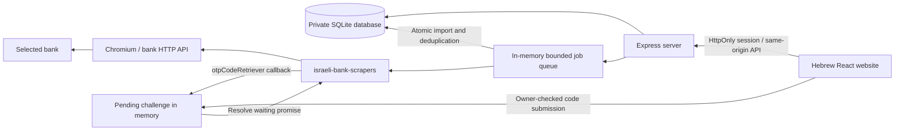
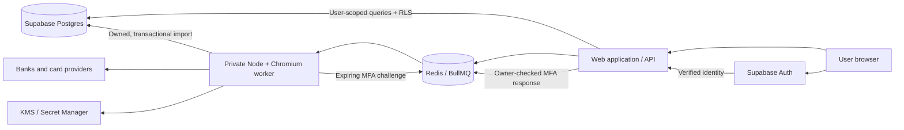

# Multi-user deployment design

## Current implementation

The browser never controls arbitrary scraping destinations and never accesses the database or Chromium directly. Every connection operation checks its owning `user_id`. Job status, OTP submission, and cancellation also check ownership. Only safe status/error text is returned; bank error payloads and credentials are not logged. Dates are grouped using the scraper's date output, and monetary arithmetic uses integer hundredths.

Jobs retain transient credentials and callback handles in server memory. OTPs are accepted only for the active challenge, expire after two minutes, and cannot be replayed. Cancelling or timing out aborts the run and closes its owned browser. Completed transactions and balances commit in one SQLite transaction. A crash is marked as an interrupted job on restart; a user must start a new sync.

## Recommended hosted architecture

### Tables and access

- `connections`: `id`, `user_id`, `provider`, display name, last sync time. Users can read/create/update/delete their own metadata.
- `bank_credentials`: `connection_id`, `user_id`, ciphertext, nonce/tag, wrapped encryption key version. No browser SELECT policy. Only the private worker can decrypt. The API accepts credential replacement or deletion, never returns plaintext. Keep this outside automatically exposed public schemas if possible.
- `accounts`: `id`, `user_id`, `connection_id`, account identity, currency, balance and as-of time. Users read their own accounts; the trusted worker writes verified ownership.
- `transactions`: `id`, `user_id`, `account_id`, source identifier/fingerprint, dates, description, amount in appropriate minor units, currency, status, category. Unique constraint on account + source fingerprint; index on `(user_id, date DESC, id)` for cursor pagination.
- `sync_runs`: `id`, `user_id`, `connection_id`, state, times, imported count, safe error code. Never include passwords, OTPs, or full bank responses.
- `preferences`: one row per `user_id`; sync range, installment preference, timezone `Asia/Jerusalem`.

Enable RLS on every user-owned table. Read policies must use `auth.uid() = user_id`; writes need both `USING` and `WITH CHECK`, depending on operation. Do not rely on a `user_id` supplied by a client. For child rows, enforce ownership with composite foreign keys such as `(connection_id, user_id)` referencing `(id, user_id)` on `connections`, rather than trusting an independently writable owner column. A service-role worker bypasses RLS, so it must validate the connection and job owner before every run and import. Keep its service key server-side.

### Authentication

Use verified email OTP/magic link for a low-friction default, with optional Google OAuth. Require or encourage Supabase TOTP for sensitive actions such as revealing full account details, changing credentials, or exporting all data. Use PKCE for OAuth and allowlist redirect URLs. Application authentication MFA and bank MFA are separate steps.

The existing local scrypt login is useful for this runnable MVP. Moving to Supabase requires replacing `/api/auth/*` and session verification; the app currently does not consume a Supabase JWT. Keep bank credential storage separate from authentication-provider data. Local user IDs require an explicit migration to the new provider's IDs.

### MFA and long-running work

The web API enqueues a job and returns immediately. A worker publishes a challenge with job ID, owner, provider, expiry, and a nonce. Use authenticated polling or SSE to open the dialog. Accept the response only from that owner, for that still-active challenge. Deliver the code through a short-lived channel to the worker holding the browser session. Delete it immediately; do not put it in persistent Redis snapshots, tracing, request logs, job payload history, or analytics.

Redis alone does not make a Chromium session resumable after a worker crash. Mark the job interrupted and start a new bank login. Some providers require approval in a separate bank app or have no callback in the library; implement provider-specific adapters before claiming popup support for them. Do not repeatedly submit a failed code automatically.

### Deployment sequence

1. Create a Supabase project in a region suitable for the users and applicable data requirements. Configure Auth, redirect URLs, and email delivery.
2. Create owned tables, indexes, composite foreign keys, and RLS policies. Test with two unrelated users and anonymous requests before importing financial data.
3. Move the database adapter from synchronous SQLite to Postgres; push filtering, aggregations, and pagination into SQL. Migrate local IDs and minor-unit rules explicitly.
4. Deploy the worker in a restricted container with compatible Chromium, provider egress, managed encryption keys, concurrency limits, and per-run cleanup. Prefer a working browser sandbox in production.
5. Add BullMQ/Redis, expiring MFA channels, tenant limits, job ownership validation, and interrupt/retry behavior. The current in-process queue must not be scaled to multiple API replicas.
6. Deploy the web/API behind HTTPS and configure secure cookies, exact origins, rate limiting with known proxy hops, and log redaction.
7. Test real bank accounts with authorization, including incorrect credentials, MFA timeout, cancellation, duplicate imports, bank outages, and changing pending transactions. No live result is inferred from demo tests.
8. Configure encrypted backups, restore checks, retention, per-user export and account deletion, monitoring, and migration/rollback procedures.

No infrastructure has been provisioned by this project. These are implementation recommendations, not a claim that the hosted components are connected.
