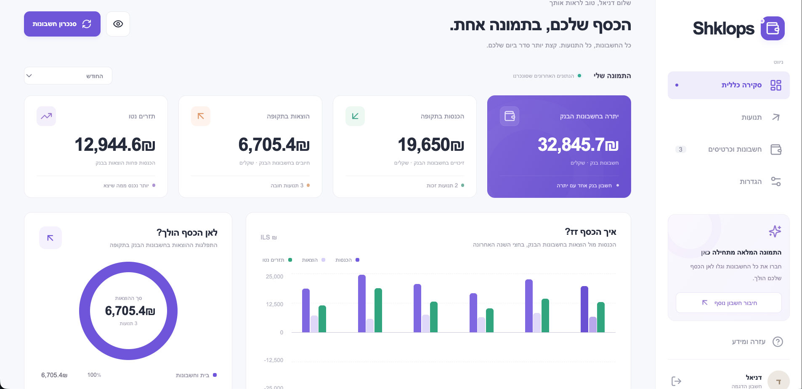

# Shklops

A Hebrew, right-to-left personal finance website using the pinned MIT-licensed `israeli-bank-scrapers` source in `vendor/israeli-bank-scrapers/`. This repository contains Shklops and its scraper dependency.



## What is implemented

- Registration and login, scrypt password hashes, HttpOnly session cookies, server-side session revocation, rate limits, and same-origin write checks.
- Private connections, accounts, transactions, settings, and sync history for each user. Bank credentials never appear in API responses.
- A dashboard with bank balances, income, expenses, category totals, six-month bank cash flow, upcoming charges from every selected card with a known total, and a selectable monthly closing-balance scenario. Each selected month independently starts with the current bank balance, adds one configured monthly net income, and subtracts one prior-month mortgage estimate plus card debits. A dated total card debit applies only to its billing month. Other months include only known future card charges and remaining installment payments, so an incomplete card bill is labeled partial. No prior month's total is copied forward. Other variable expenses are excluded.
- Cal credit cards show the next debit amount and date when returned by the scraper. Isracard and Amex report credit-line usage as their balance, so their cards instead show an explicitly partial estimate from completed transactions with the nearest future billing date; cards without such transactions show an unknown upcoming amount. New purchases may change the final bill.
- Separate searchable, filterable, paginated bank and credit-card transaction tabs with filtered CSV export. The card tab can show a selected billing month or the next payment; month filtering uses the synced billing date and excludes pending or undated transactions. Remaining payments of a synced installment purchase appear in their future billing months as clearly marked projections until actual rows are synced.
- Provider-specific connection forms from the scraper library's metadata; optional AES-256-GCM encryption of remembered bank credentials. Without opt-in, credentials are used only for that run.
- Manual sync jobs, progress, cancellation, timeout handling, transactional imports, and duplicate detection.
- An MFA dialog that resumes the waiting scraper callback. ONE ZERO exposes this callback in the current library. Other providers do **not** automatically gain MFA support; unsupported bank challenges report failure and may require action on the bank's website.
- An isolated demo account per browser session, synthetic data, and an explicit simulated MFA flow. No bank is contacted by the demo.
- Responsive desktop and mobile layouts. No external fonts, trackers, or CDNs are required.

## Run on your computer

Install **Node.js 22.22.2 or newer** and Git, then clone this repository:

```bash
git clone https://github.com/int21asm/shklops.git
cd shklops
node start-demo.mjs
```

The launcher works from Terminal or PowerShell. It installs the pinned scraper dependencies, builds that library, installs the web app, builds it, and starts a local server. The first run requires internet access for npm packages.

Open **http://localhost:3002** in a browser on the same computer. Keep the terminal open; Ctrl+C stops the server. The launcher binds to localhost and explicitly disables live bank scraping.

Alternatively, use GitHub's **Code → Download ZIP**. Extract the archive, open a terminal in its root directory, and run `node start-demo.mjs`.

After the first successful setup, `npm start` starts the built app without reinstalling. For hot reload, run `npm run dev`. On PowerShell, set `$env:NODE_ENV = "development"` and run `node --env-file-if-exists=.env --watch server/index.js` instead of the Unix-style `npm run dev` command. These commands load `.env` if present.

The HTTP server serves both the API and website on port **3002**. The web demo does not require Electron processes, a desktop keyring, a virtual display, or Chromium. Chromium is needed only for live browser-based bank scraping and the browser test suite.

Choose **כניסה להדגמה עם נתונים לדוגמה** to explore immediately. To try MFA, open **חשבונות וכרטיסים**, sync **חשבון משותף · הדגמת אימות**, and enter `123456`. Any 4–10 digit code is accepted by the synthetic adapter; this does not validate a real OTP. The dialog labels that distinction.

To create a real application login, choose **חשבון חדש**, enter a name, email address, and password with at least 12 characters. This local implementation does not verify email addresses or provide password reset or account MFA. The production recommendation below replaces it with managed authentication.

### Checks

```bash
npm test
npm run build
# With the built app running on port 3002:
npm run test:browser
```

The API tests use temporary databases, not application data. They verify login/logout, CSRF, ownership boundaries, encryption, credential non-disclosure, MFA completion/expiry/replay/cancellation, persisted imports, and deduplication. Browser tests exercise the Hebrew UI, saved preferences, adding connections, MFA completion, filters, CSV downloads, and mobile layout. Screenshots go to ignored `test-results/`.

The automated tests exercise the real server workflow with an injected scraper
adapter. A local Mizrahi account was refreshed successfully on 2026-10-20 using
previously saved credentials; its response included transactions but no usable
API balance. A verified Mizrahi-specific fallback now reads the current-account
balance header, or the latest dated ledger balance if the header is unavailable.
This verifies that connection, not every provider or account. Each bank
must be checked using an authorized account before claiming its live connection works.

## Enable live scraping

Live scraping is disabled by default. The server rejects bank credentials while disabled. An authenticated user can still prepare a connection without credentials.

After the initial `node start-demo.mjs` install/build, stop the demo with Ctrl+C and start the local website with real bank connections:

```bash
npm run start:live
```

This explicit launcher enables live scraping, binds to `127.0.0.1`, and finds an
installed Chrome/Chromium on macOS, Linux, or Windows. Set `CHROMIUM_PATH` in `.env`
if your browser is elsewhere. It loads the existing local database and keeps demo
accounts synthetic. `node start-demo.mjs` still forces demo mode.

For a fresh live-only setup, install and build everything before `npm run start:live`:

```bash
cd vendor/israeli-bank-scrapers
npm ci
npm run build
cd ../..
npm ci
npm run build
npm run start:live
```

If your shell selects an older Node version, switch to Node.js 22.22.2 or newer
before running these commands. On macOS with Homebrew Node installed, you can use
`PATH=/opt/homebrew/bin:$PATH npm run start:live`.

Open **http://localhost:3002**, reload an already-open page, and sign in or register
a personal application account. Under **חשבונות וכרטיסים**, add your provider and
connection name, then click its sync button to enter bank credentials. Alternatively,
select the optional encrypted credential storage checkbox while adding the
connection. Keep the page open for supported bank MFA challenges.

For an authorized local test, set `ENABLE_LIVE_SCRAPING=true`, configure Chromium, restart the server, then create a non-demo user and connect a bank. Without “remember credentials,” the user must enter credentials for each sync. Do not use a demo account for live tests.

```dotenv
PORT=3002
ENABLE_LIVE_SCRAPING=true
CHROMIUM_PATH=/usr/bin/chromium
# Required only in this container where Chromium's OS sandbox is unavailable:
CHROMIUM_NO_SANDBOX=1
```

Provider URLs come from the library rather than user input. The environment's network allowlist must permit the selected bank's endpoints and legitimate redirects. ONE ZERO uses `identity.tfd-bank.com` and `mobile.tfd-bank.com`. The original onboarding environment did not have bank-network access configured; configure egress for your own runtime before live tests. Do not disable TLS verification to bypass network failures. An MFA popup requires the user to keep the site open until the code is requested; polling also recovers a challenge after a reload in the same running server.

The worker limits concurrency to two runs, queues at most ten, waits up to two minutes for MFA, and caps each run at five minutes. Jobs are intentionally in memory in this first version; restart interrupts them, while committed transactions survive. There is no recurring schedule. Launch exactly one server process for this SQLite implementation.

## Data storage and authentication recommendation

For a multi-user deployment, I recommend:

| Concern                                   | Recommendation                                                                                                                                                                       |
| ----------------------------------------- | ------------------------------------------------------------------------------------------------------------------------------------------------------------------------------------ |
| Accounts, transactions, preferences       | **Supabase Postgres**, with `user_id` on every owned row, foreign keys, and row-level security based on `auth.uid()`                                                                 |
| User login                                | **Supabase Auth**: verified email OTP/magic link or Google sign-in; offer TOTP for application MFA separately from a bank's OTP                                                      |
| Bank passwords and long-lived bank tokens | Encrypt with an envelope key managed by **KMS/Secret Manager**, outside the database; decrypt only in the worker; remembering credentials stays optional                             |
| Scraping                                  | A separate **Node + Chromium container**, e.g. Cloud Run with suitable execution limits or a persistent container service; not a frontend or short-lived request handler             |
| Jobs and MFA handoff                      | **BullMQ + Redis**, authenticated job ownership checks, short-lived challenges, timeouts; OTPs never in durable database rows, logs, or analytics                                    |
| Files and backups                         | Encrypted Postgres backups with a retention policy and restore test. Use private object storage only if exports are retained; CSV downloads here are generated in the user's browser |

There is no Supabase connection or Google login configured in this code. See [ARCHITECTURE.md](ARCHITECTURE.md) for the migration and deployment boundaries.

### Current local data

`.data/finance.sqlite` contains users, hashed sessions, settings, connection metadata, accounts, transactions, and run history. `.data/credential.key` is a locally generated 32-byte key used to encrypt remembered bank credentials. The directory has restrictive permissions and is ignored by Git. Application data and a local decryption key on the same disk are **development storage**, not a production vault. The SQLite financial tables themselves are not encrypted by this application.

Back up the database and its credential key together securely. For a consistent live backup use SQLite's backup facilities; do not copy a WAL database file in isolation. Deleting a connection cascades to its accounts, transactions, saved credentials, and runs. No raw bank-response dumps, OTPs, or screenshots are stored. Account numbers are retained in the database and masked to the final four digits in the UI.

## Before internet deployment

Use managed authentication with verified identities, password recovery, and account MFA; configure the Postgres/RLS and worker architecture above. The current code is a functional local MVP, not a completed hosted production service.

At minimum, a deployment of the current server requires `NODE_ENV=production`, an exact HTTPS `APP_ORIGIN`, and a base64 32-byte `CREDENTIAL_KEY` supplied through a secret manager. Production startup rejects missing key/origin configuration; cookies become Secure and use the `__Host-` prefix. Do not put a key in a source file or provide it in chat. Terminate TLS at a controlled proxy, restrict direct worker access, and set proxy trust deliberately if rate limits must use client IPs. Do not blindly enable `trust proxy` for arbitrary forwarded headers.

The bank-MFA dialog is **not** application-login MFA. Adding a browser-visible OTP field for a bank does not strengthen the application's account authentication.

## Known limits

- Transaction timestamps are grouped by the Israeli calendar (`Asia/Jerusalem`).
  Resync corrects matching rows imported with the previous UTC-date conversion;
  original source timestamps are retained for future imports. Missing bank balances
  are shown as unavailable; partial ILS balance totals are labeled explicitly.
- Provider availability changes with bank websites. A real success is reported only after the scraper returns a successful result and the import commits.
- Most providers use bank transaction identifiers to deduplicate repeated imports. Mizrahi uses a content fingerprint because its reference numbers can change between syncs. Where identifiers are absent or unstable, date, amount, description, currency, installment, and occurrence preserve identical purchases but cannot perfectly reconcile changing bank descriptions or dates. Cross-provider transfers are not matched, so both sides remain visible.
- Categories are simple Hebrew/text heuristics, not bank-certified classifications or an AI model.
- Amounts are stored in integer hundredths, suitable for ILS; there is no exchange-rate conversion or general accounting support for currencies with other minor-unit scales.
- The UI fetches at most 10,000 latest transactions and explicitly warns when summaries/export cover a truncated dataset. A production implementation should move filtering, aggregation, and cursor pagination to Postgres.
- No automatic schedules, exports to Google Sheets/YNAB, push notifications, account recovery, durable worker resume, or subscription billing are implemented.
- Demo users are persistent local rows for testing; a hosted public demo needs automatic expiry and cleanup.

## Attribution

Uses [israeli-bank-scrapers](https://github.com/eshaham/israeli-bank-scrapers), from the pinned `int21asm/israeli-bank-scrapers` checkout, under its MIT license. The web workflow is inspired by [כספיון](https://github.com/brafdlog/caspion), also MIT. Shklops is an independent interface, not an official bank service.
